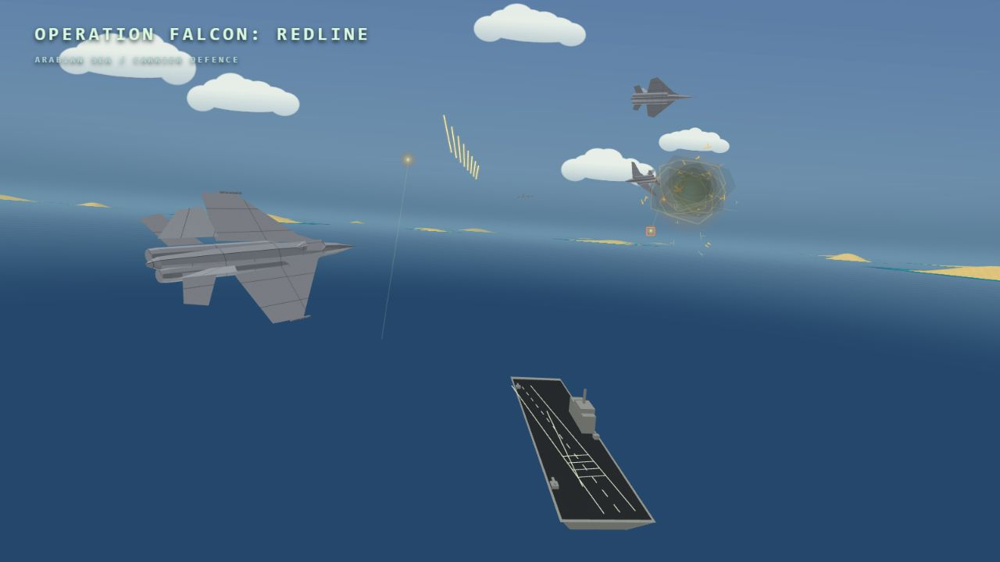

# Operation Falcon: Redline



Böngészős repülőszimulátor magyar és angol kezelőfelülettel, 120 Hz-es repülésfizikával, küldetésekkel és helyben futó gépi ellenfelekkel. A 3D világ, a HUD, a műszerfal, a radar és az effektek alapértelmezetten WebGPU-val jelennek meg. A menük HTML-alapúak. A játékhoz nincs külső futásidejű hálózati függőség vagy felhős AI-szolgáltatás; a rádiófelvételek helyi fájlok.

## Indítás

Az elsődleges fejlesztői verzió **Node.js 26.12.0**, az `.nvmrc` szerint. A támogatott LTS ág **24.22.0 vagy újabb 24.x**. A CI mindkét ágat a legfrissebb elérhető javítóverzióval ellenőrzi.

```sh
npm ci --ignore-scripts
npm start
```

A játék: [localhost:5173](http://localhost:5173). Más portot a `PORT` környezeti változóval lehet megadni. A szerver kizárólag `127.0.0.1`-en hallgatózik; nem publikus éles webszerver. A fejlesztői csomagok a kódellenőrzéshez kellenek, nem kerülnek a böngészőbe.

## Fejlesztés és ellenőrzés

```sh
npm run verify       # teljes szintaxis, lint, formázás és minden Node-teszt
npm run format       # egységes Prettier formázás
npm run lint         # ESLint, hibát jelent a holt változókra/importokra is
npm audit            # közvetlen és tranzitív fejlesztői csomagok ellenőrzése
```

A `check` minden JS/MJS forrást ellenőriz, nem csak a belépőfájlt. Az architektúratesztek ellenőrzik az importok feloldhatóságát, a körkörös függőségek hiányát, valamint a harci és shader-életciklus modulok DOM-függetlenségét. A fizikát és a játékmenetet külön regressziós tesztek fedik le.

A böngészős próbák a `tests/*.html` oldalakon érhetők el, például `/tests/naval-cockpit.html` és `/tests/mission-performance.html`. Ezek fejlesztői diagnosztikai oldalak. FPS-t csak érvényes frissítési ütem mellett mérj; háttérbe tett lap lassítása nem hardverteljesítmény-mérés. A rádiógeneráló offline eszközök a `scripts/` mappában vannak; generálás után futtasd a formázást és ellenőrzést.

## Játékszabályok és kézikönyv

A **Légiutántöltés / Operation Lifeline** küldetés mindkét oldalról játszható, külön KC–135R tankerrel, tényleges üzemanyag-átadással és repülőtér nélküli győzelmi feltételekkel. A [részletes szabályok és tankolási segítség](docs/aerial-refuelling.md) a fejlesztői dokumentációban is elérhetők.

Az aktuális irányítás, küldetések, gépek, fegyverek és célkorlátozások a játékbeli **Egységtárban** (`/encyclopedia.html`) olvashatók. A [pilótaútmutató](tutorial.html) nyomtatható leírás. A részletes küldetéslistát és a fegyverzetet a hangár az élő adatmodellekből állítja össze.

A kezdőképernyő három lépése: **világtérképes küldetésválasztás → térbeli gépkatalógus → fegyverzet és üzemanyag**. A gépkártyákon csak az adott feladatra használható típusok szerepelnek, ajánlási sorrendben. A ⓘ gombok ugyanazon az oldalon, bezárható dialógusban nyitják a teljes kézikönyvet, a megfelelő gép- vagy fegyveradatlapnál.

A `missionLocations.js` rögzíti mind a 16 küldetés földrajzi helyét és táját. A helyek fiktív műveletek valós térségekben; nem földrajzilag pontos domborzatot töltenek be. A procedurális terep elrendezése változhat, a tájpaletta küldetésenként állandó. Minden textúrázott táj legalább egy feladatnál szerepel, a négy gyakorlat amerikai helyszínű, a havas bázisvédelem Észak-Finnországban, a tengeri művelet az Arab-tengeren játszódik. A helyi világtérkép Natural Earth public-domain körvonalakból készült; nem használ külső térképszolgáltatást.

Az új **Berepülés** kategória Edwards és Zsukovszkij fegyvertelen tesztprogramját adja, három-három különleges kísérleti géppel. Felszállás, típushoz igazított magasság/IAS, stabil repülés, bal/jobb forduló és biztonságos hazatérés szükséges. A történeti források, becslések és kapcsolódó B-52/rakéta-javítások: [Berepülési program](docs/flight-test-program.md).

A katalógus három gépkártyát, magasabb asztali ablakban 2×3 kártyát mutat oldalanként: nyugati gépek, majd szovjet, orosz és kínai gépek. A kártyákon csak zászló, gépnév és kitöltött térbeli modell szerepel; a műszaki adatok és a wiki linkje külön adatpanelen vannak. A gépválasztás automatikusan meghatározza az oldalt; a kártyákon és a wiki adatlapjain helyi SVG-zászlók jelzik a fejlesztő országokat. Lapozás: nyilak, bal/jobb billentyű vagy oldalra húzás. Lapozáskor az oldal első gépe lesz kiválasztva, a többi kártyára kattintva másik típus jelölhető ki. Az oldalfüggő célok és eredmények a `missionSides`, `sideObjectives` és `sideRuntime` modulokban vannak. A `sideBattle` a közös hadszíntéren felcseréli a csapatokat és a játékost az ellenoldal egyik valódi géphelyére teszi; a korábbi játékos helyét AI veszi át. A keleti tengeri támadás három repülős társat és baráti rombolót kap, négy nyugati fedélzeti gép ellen; saját fedélzet híján biztonságos kivonulással zárul. A szárazföldi változatok saját hátsó repteret használnak. Konvoj és légi ellenfél nélküli reptércsapás esetén az indulás és a feladat nem fordul meg.

A `coalitionRoster` küldetésenként szovjet, orosz, kínai vagy vegyes keleti vadászösszetételt választ. Önálló kínai bombázómodell hiányában homogén kínai kötelék csak vadászokból állhat; a bombázós homogén változatok szovjet/orosz típusokat használnak. A napló a választott oldalt és a tényleges gép-/csapatkiosztást is rögzíti.

A repülési napló csak az aktuális küldetést tárolja a böngésző IndexedDB-adatbázisában. Új küldetés lecseréli; a JSON-export a `/flight-log.html` oldalon tölthető le. A napló és a kiértékelés helyben marad. Ne tegyél személyes adatot vagy naplót nyilvános hibajegybe.

## Automatikus ellenőrzések GitHubon

A workflow-k pushra, pull requestre és kézi indításra is futnak. Esti ütemezés **Europe/Budapest** időzónában, a nyári/téli időszámítást követve:

| Ellenőrzés                            | Tervezett idő |
| ------------------------------------- | ------------- |
| Teljes minőségellenőrzés és npm audit | 22:15         |
| Dependabot npm-verziófrissítések      | 22:30         |
| Dependabot GitHub Actions-frissítések | 22:40         |
| CodeQL: JavaScript, Python és Actions | 22:45         |

A Dependabot külön szolgáltatás, nem saját Actions-lépés. Az Actions-hivatkozások teljes commitazonosítóhoz vannak rögzítve, módosításukra a Dependabot tesz javaslatot. A workflow-k minimális tokenjogosultságot és időkorlátot használnak; nincs automatikus merge vagy publish.

Az ütemezések a workflow-fájlok **alapértelmezett ágra történő feltöltése után** működnek, ha az Actions és a code scanning engedélyezett. Meglévő CodeQL default setup mellett az advanced workflow használatához a beállításokat is egyeztetni kell. A GitHub késleltetheti az ütemezett futást, és inaktív publikus repóban letilthatja azt. A Dependabot alerts/automatikus security update külön repóbeállítás; a verziófrissítési konfiguráció nem kapcsolja be helyettük ezeket.

## Felépítés és biztonság

- [Architektúra és réteghatárok](docs/architecture.md)
- [Csillagos küldetésértékelés, visszajátszás és menüzene](docs/mission-results.md)
- [Biztonsági áttekintés és helyi ellenőrzések](docs/security-review.md)
- [Vulnerabilitás bejelentése](.github/SECURITY.md)
- [Archivált fejlesztési feljegyzések](docs/archive/development-notes.md)

A WebGPU böngésző-API; működő adapterhez támogatott böngésző és grafikus illesztőprogram kell. A korábbi WebGL2/Canvas-változat `?backend=webgl`, a Canvas2D-változat `?backend=cpu` paraméterrel érhető el összehasonlításhoz. Az alapértelmezett WebGPU-útvonal nem kér Canvas2D- vagy WebGL-kontextust. Részletek és vizuális tesztoldalak: [WebGPU-megjelenítés](docs/rendering-webgpu.md).

## Nyelvek

A fejlécben magyar és angol felület választható. Első indításkor a böngésző támogatott nyelve érvényes; más nyelvnél angol az alapértelmezés. A kézi választás a `falcon-language` helyi beállításban marad meg. Váltáskor a bevetés, felszerelés és repülési állapot megmarad; a wiki és a naplónézet is követi a választást. A hangfelvételek minden nyelven angolok, a rádiófeliratok fordíthatók.

Az i18next rögzített npm-függőség, helyi ESM-példánya az `assets/vendor/i18next/` alatt van. Az `npm install`/`npm ci` utáni `postinstall` frissíti a böngészős példányt és MIT-licencet; kézzel `npm run vendor:sync` futtatható. Játék közben nincs CDN vagy fordítószolgáltatás. A szótár: `src/locales/messages.json`. Minden forrásszöveghez teljes magyar/angol pár tartozik; a `{{v0}}` jellegű helyőrzőket meg kell őrizni. A megjelenítési réteg fordít, a szimuláció belső azonosítói és a naplóadatok változatlanok. A nyomtatható útmutató és a wiki közös fejezetadatokat használ.

Az új [Invázió: Tajvan](docs/taiwan-invasion.md) bevetés a közös hullám-, harci és feltöltési rendszerekből épül fel.

A [közös repülési modell](docs/flight-model.md) széllel, hajtómű-késleltetéssel, forgási csillapítással, talajhatással és Mach-függő hullámellenállással működik. A mérő- és elemzőscript exportált repülési naplókból ellenőrzi a működést.
