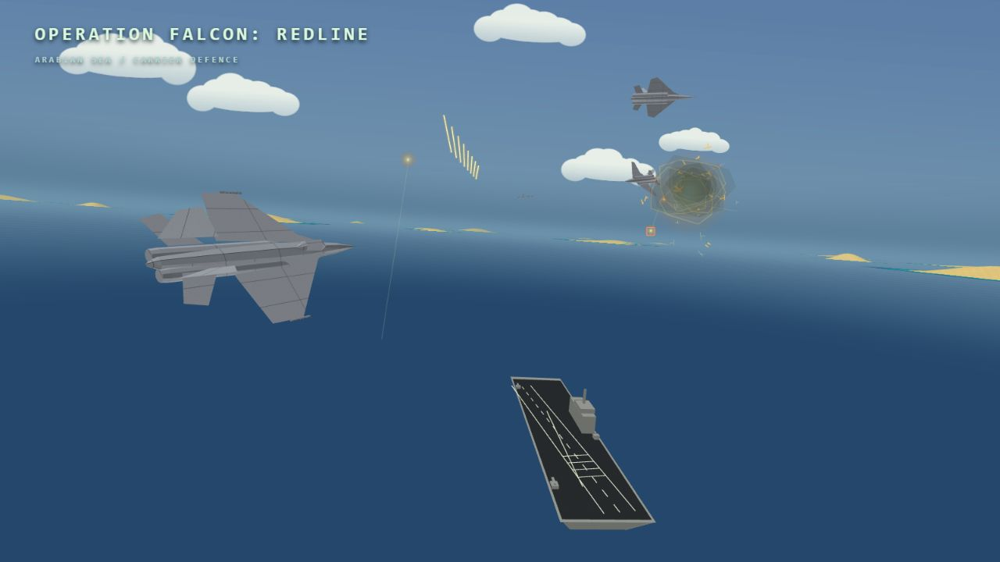

# Operation Falcon: Redline



Böngészős repülőszimulátor magyar és angol kezelőfelülettel, 120 Hz-es repülésfizikával, küldetésekkel és helyben futó gépi ellenfelekkel. A 3D világ, a HUD, a műszerfal, a radar és az effektek alapértelmezetten WebGPU-val jelennek meg. A menük HTML-alapúak. A játékhoz nincs külső futásidejű hálózati függőség vagy felhős AI-szolgáltatás; a rádiófelvételek helyi fájlok.

## Indítás

Az elsődleges fejlesztői verzió **Node.js 26.12.0**, az `.nvmrc` szerint. A támogatott LTS ág **24.22.0 vagy újabb 24.x**. A CI mindkét ágat a legfrissebb elérhető javítóverzióval ellenőrzi.

```sh
npm ci --ignore-scripts
npm start
```

A játék: [localhost:5173](http://localhost:5173). Más portot a `PORT` környezeti változóval lehet megadni. A szerver kizárólag `127.0.0.1`-en hallgatózik; nem publikus éles webszerver. A fejlesztői csomagok a kódellenőrzéshez kellenek, nem kerülnek a böngészőbe.

## Docker · Linux konténer

Docker Engine / Docker Desktop Linux-konténerekkel és Docker Compose szükséges. A repó gyökerében:

```sh
docker compose up -d --build
```

Játék: [localhost:5173](http://localhost:5173), multiplayer: [localhost:5173/multiplayer.html](http://localhost:5173/multiplayer.html).
Az 5173-as port legyen szabad; ha ott már helyi Node-szerver fut, állítsd le, vagy válassz másik külső portot.

```sh
docker compose ps                  # állapot és healthcheck
docker compose logs -f game        # szervernapló
docker stats                       # tényleges memória- és CPU-használat
docker compose down                # leállítás
```

A kép rögzített hivatalos **Node 24 LTS + Alpine Linux** alapot használ. Csak a futáshoz szükséges fájlokat és production függőségeket tartalmazza; fejlesztői eszközök, tesztek, Git és helyi beállítások nem kerülnek bele. Nem root felhasználóként, csak olvasható fájlrendszerrel fut. Nincs adatbázis, háttérböngésző vagy szerveroldali GPU. A grafika és az egyjátékos szimuláció a játékos böngészőjét terheli; a multiplayer szimuláció a konténerben fut. A szobák memóriában élnek, konténer-újraindításkor megszűnnek.

Alapértelmezett felső korlát **512 MiB RAM és 1 CPU**; ez nem lefoglalt vagy folyamatosan elfogyasztott erőforrás. Egyszerre egy szoba nyitható, benne legfeljebb öt pilótával. A részletes napló mérete korlátozott, a healthcheck rendszeresen ellenőrzi a HTTP-kiszolgálást.

Opcionális beállítások: másold a `.env.docker.example` fájlt `.env` néven a repó gyökerébe. A `FALCON_PORT` a külső portot, a `FALCON_MEMORY_LIMIT` és `FALCON_CPUS` a korlátokat állítja. A konténeren belüli port mindig 5173. Módosítás után futtasd újra a `docker compose up -d --build` parancsot.

Alapból csak a saját gépedről érhető el. LAN-kapcsolathoz állítsd a `FALCON_BIND_ADDRESS` értékét `0.0.0.0`-ra, és az `ALLOWED_HOSTS` értékébe írd a böngészőben használt pontos címet porttal, például `192.168.1.50:5173` (több cím vesszővel elválasztva). A webszerver és a WebSocket ugyanazon a porton fut. A WebGPU távoli gépről biztonságos böngészőkörnyezetet, általában HTTPS-t igényel; a `localhost` helyi HTTP-címe kivétel. Internetes használatnál HTTPS/WSS-t biztosító fordított proxy és a szerver host/origin szabályaihoz illeszkedő telepítés szükséges.

Compose nélkül is indítható:

```sh
docker build -t operation-falcon:local .
docker run -d --name operation-falcon --init --read-only --cap-drop ALL --security-opt no-new-privileges --memory 512m --cpus 1 -p 127.0.0.1:5173:5173 operation-falcon:local
```

## Fejlesztés és ellenőrzés

```sh
npm run verify       # teljes szintaxis, lint, formázás és minden Node-teszt
npm run format       # egységes Prettier formázás
npm run lint         # ESLint, hibát jelent a holt változókra/importokra is
npm audit            # közvetlen és tranzitív fejlesztői csomagok ellenőrzése
```

A `check` minden JS/MJS forrást ellenőriz, nem csak a belépőfájlt. Az architektúratesztek ellenőrzik az importok feloldhatóságát, a körkörös függőségek hiányát, valamint a harci és shader-életciklus modulok DOM-függetlenségét. A fizikát és a játékmenetet külön regressziós tesztek fedik le.

A böngészős próbák a `tests/*.html` oldalakon érhetők el, például `/tests/naval-cockpit.html` és `/tests/mission-performance.html`. Ezek fejlesztői diagnosztikai oldalak. FPS-t csak érvényes frissítési ütem mellett mérj; háttérbe tett lap lassítása nem hardverteljesítmény-mérés. A rádiógeneráló offline eszközök a `scripts/` mappában vannak; generálás után futtasd a formázást és ellenőrzést.

## Játékszabályok és kézikönyv

A **Légiutántöltés / Operation Lifeline** küldetés mindkét oldalról játszható, külön KC–135R tankerrel, tényleges üzemanyag-átadással és repülőtér nélküli győzelmi feltételekkel. A [részletes szabályok és tankolási segítség](docs/aerial-refuelling.md) a fejlesztői dokumentációban is elérhetők.

Az aktuális irányítás, küldetések, gépek, fegyverek és célkorlátozások a játékbeli **Egységtárban** (`/encyclopedia.html`) olvashatók. A [pilótaútmutató](tutorial.html) nyomtatható leírás. A részletes küldetéslistát és a fegyverzetet a hangár az élő adatmodellekből állítja össze.

A kezdőképernyő három lépése: **világtérképes küldetésválasztás → térbeli gépkatalógus → fegyverzet és üzemanyag**. A gépkártyákon csak az adott feladatra használható típusok szerepelnek, ajánlási sorrendben. A ⓘ gombok ugyanazon az oldalon, bezárható dialógusban nyitják a teljes kézikönyvet, a megfelelő gép- vagy fegyveradatlapnál.

A `missionLocations.js` rögzíti mind a 16 küldetés földrajzi helyét és táját. A helyek fiktív műveletek valós térségekben; nem földrajzilag pontos domborzatot töltenek be. A procedurális terep elrendezése változhat, a tájpaletta küldetésenként állandó. Minden textúrázott táj legalább egy feladatnál szerepel, a négy gyakorlat amerikai helyszínű, a havas bázisvédelem Észak-Finnországban, a tengeri művelet az Arab-tengeren játszódik. A helyi világtérkép Natural Earth public-domain körvonalakból készült; nem használ külső térképszolgáltatást.

Az új **Berepülés** kategória Edwards és Zsukovszkij fegyvertelen tesztprogramját adja, három-három különleges kísérleti géppel. Felszállás, típushoz igazított magasság/IAS, stabil repülés, bal/jobb forduló és biztonságos hazatérés szükséges. A történeti források, becslések és kapcsolódó B-52/rakéta-javítások: [Berepülési program](docs/flight-test-program.md).

A katalógus három gépkártyát, magasabb asztali ablakban 2×3 kártyát mutat oldalanként: nyugati gépek, majd szovjet, orosz és kínai gépek. A kártyákon csak zászló, gépnév és kitöltött térbeli modell szerepel; a műszaki adatok és a wiki linkje külön adatpanelen vannak. A gépválasztás automatikusan meghatározza az oldalt; a kártyákon és a wiki adatlapjain helyi SVG-zászlók jelzik a fejlesztő országokat. Lapozás: nyilak, bal/jobb billentyű vagy oldalra húzás. Lapozáskor az oldal első gépe lesz kiválasztva, a többi kártyára kattintva másik típus jelölhető ki. Az oldalfüggő célok és eredmények a `missionSides`, `sideObjectives` és `sideRuntime` modulokban vannak. A `sideBattle` a közös hadszíntéren felcseréli a csapatokat és a játékost az ellenoldal egyik valódi géphelyére teszi; a korábbi játékos helyét AI veszi át. A keleti tengeri támadás három repülős társat és baráti rombolót kap, négy nyugati fedélzeti gép ellen; saját fedélzet híján biztonságos kivonulással zárul. A szárazföldi változatok saját hátsó repteret használnak. Konvoj és légi ellenfél nélküli reptércsapás esetén az indulás és a feladat nem fordul meg.

A `coalitionRoster` küldetésenként szovjet, orosz, kínai vagy vegyes keleti vadászösszetételt választ. Önálló kínai bombázómodell hiányában homogén kínai kötelék csak vadászokból állhat; a bombázós homogén változatok szovjet/orosz típusokat használnak. A napló a választott oldalt és a tényleges gép-/csapatkiosztást is rögzíti.

A repülési napló csak az aktuális küldetést tárolja a böngésző IndexedDB-adatbázisában. Új küldetés lecseréli; a JSON-export a `/flight-log.html` oldalon tölthető le. A napló és a kiértékelés helyben marad. Ne tegyél személyes adatot vagy naplót nyilvános hibajegybe.

## HTTPS proxy mögötti tesztkörnyezet

A konténer HTTP-n figyelhet, miközben a felhős belépési pont HTTPS/WSS-t biztosít. Ilyenkor állítsd be a `PUBLIC_ORIGIN` értékét a böngészőben használt pontos HTTPS-originre (például `https://falcon.example.com`), és az `ALLOWED_HOSTS` értékét ugyanarra a hostnévre (`falcon.example.com`). Nem szabványos port esetén mindkettőben add meg a portot is. A proxy őrizze meg a böngésző eredeti Host fejlécét.

A `PUBLIC_ORIGIN` csak HTTPS-origint fogad el, útvonal, query és bejelentkezési adatok nélkül. Üres értékkel a korábbi közvetlen HTTP/HTTPS-ellenőrzés marad érvényben, így a helyi futtatáshoz nem kell módosítás. A szerver nem bízik meg az `X-Forwarded-*` vagy `Forwarded` fejlécekben; a megadott origin és az engedélyezett Host együtt szükséges a WebSocket-kapcsolathoz.

A multiplayer szobák memóriában élnek; az első teszttelepítést egyetlen példánnyal és egy aktív revízióval futtasd. Újraindításkor a szobák megszűnnek.

## Automatikus ellenőrzések GitHubon

A workflow-k pushra, pull requestre és kézi indításra is futnak. Esti ütemezés **Europe/Budapest** időzónában, a nyári/téli időszámítást követve:

| Ellenőrzés                            | Tervezett idő |
| ------------------------------------- | ------------- |
| Teljes minőségellenőrzés és npm audit | 22:15         |
| Dependabot npm-verziófrissítések      | 22:30         |
| Dependabot GitHub Actions-frissítések | 22:40         |
| CodeQL: JavaScript, Python és Actions | 22:45         |

A Dependabot külön szolgáltatás, nem saját Actions-lépés. Az Actions-hivatkozások teljes commitazonosítóhoz vannak rögzítve, módosításukra a Dependabot tesz javaslatot. A workflow-k minimális tokenjogosultságot és időkorlátot használnak; nincs automatikus merge vagy publish.

Az ütemezések a workflow-fájlok **alapértelmezett ágra történő feltöltése után** működnek, ha az Actions és a code scanning engedélyezett. Meglévő CodeQL default setup mellett az advanced workflow használatához a beállításokat is egyeztetni kell. A GitHub késleltetheti az ütemezett futást, és inaktív publikus repóban letilthatja azt. A Dependabot alerts/automatikus security update külön repóbeállítás; a verziófrissítési konfiguráció nem kapcsolja be helyettük ezeket.

## Felépítés és biztonság

- [Architektúra és réteghatárok](docs/architecture.md)
- [Csillagos küldetésértékelés, visszajátszás és menüzene](docs/mission-results.md)
- [Biztonsági áttekintés és helyi ellenőrzések](docs/security-review.md)
- [Vulnerabilitás bejelentése](.github/SECURITY.md)
- [Archivált fejlesztési feljegyzések](docs/archive/development-notes.md)

A WebGPU böngésző-API; működő adapterhez támogatott böngésző és grafikus illesztőprogram kell. A korábbi WebGL2/Canvas-változat `?backend=webgl`, a Canvas2D-változat `?backend=cpu` paraméterrel érhető el összehasonlításhoz. A 3D világ WebGPU-t használ; a térbeli HUD-üveget natív, átlátszó Canvas2D-réteg, a műszerfalat SVG/HTML jeleníti meg. Ezeket a böngésző komponálja össze, pixel-visszaolvasás nélkül. Részletek és vizuális tesztoldalak: [WebGPU-megjelenítés](docs/rendering-webgpu.md).

A szürke vektoros kabin lefelé nézéskor folyamatos, enyhe előre/felfelé hajlást követ: a bombacélzó a műszerfal fölött jobban látható, a padló és oldalfalak továbbra is takarnak. A kabin, a műszerfal és a világ ugyanazt a szemhelyzetet használja.

A felhők helyi, átlátszó PNG-textúrával jelennek meg; az éjszakai WebGPU/WebGL égbolt világirányhoz rögzített Tejút-panorámát használ. A képek egyszer töltődnek be, játék közben nincs képgenerálás vagy külső képszolgáltatás. A textúrák eredete és generálási leírása: [égbolttextúrák](assets/environment/sky-textures.md). Az Aster-sziget belsejében három szürke sziklacsúcs emelkedik; más szárazföldi bevetéseken véletlenszerű sziklatömbök jelenhetnek meg a védett reptéri folyosókon kívül.

## Nyelvek

A fejlécben magyar és angol felület választható. Első indításkor a böngésző támogatott nyelve érvényes; más nyelvnél angol az alapértelmezés. A kézi választás a `falcon-language` helyi beállításban marad meg. Váltáskor a bevetés, felszerelés és repülési állapot megmarad; a wiki és a naplónézet is követi a választást. A hangfelvételek minden nyelven angolok, a rádiófeliratok fordíthatók.

Az összetett feliratokban keresett szótári részleteket két karakter szerinti csoportok szűkítik.
A keresés ugyanúgy a legkorábbi helyen kezdődő, leghosszabb szöveget választja, megőrizve a
szóhatár-ellenőrzést; nem fordít le óriási reguláris kifejezést az első ismeretlen HUD-feliratnál.
A `/tests/stores-build.html?plane=b52` helyi, hang nélküli próba külön méri az első fegyverpanel
jelölőkódjának elkészítését, fordítását, DOM-beillesztését és elrendezését.

Az i18next rögzített npm-függőség, helyi ESM-példánya az `assets/vendor/i18next/` alatt van. Az `npm install`/`npm ci` utáni `postinstall` frissíti a böngészős példányt és MIT-licencet; kézzel `npm run vendor:sync` futtatható. Játék közben nincs CDN vagy fordítószolgáltatás. A szótár: `src/locales/messages.json`. Minden forrásszöveghez teljes magyar/angol pár tartozik; a `{{v0}}` jellegű helyőrzőket meg kell őrizni. A megjelenítési réteg fordít, a szimuláció belső azonosítói és a naplóadatok változatlanok. A nyomtatható útmutató és a wiki közös fejezetadatokat használ.

Az új [Invázió: Aster-sziget](docs/aster-island.md) bevetés a közös hullám-, harci és feltöltési rendszerekből épül fel.

A [közös repülési modell](docs/flight-model.md) széllel, hajtómű-késleltetéssel, forgási csillapítással, talajhatással és Mach-függő hullámellenállással működik. A mérő- és elemzőscript exportált repülési naplókból ellenőrzi a működést.

## Játékbeli névkatalógus

A megjelenő típusnevek formája: `EREDET-SZEREP-SOROZAT (Fantázianév)`, például `US-MR-101 (Skywarden)`. A repülőgépek, fegyverek, földi és tengeri rendszerek közös adatai a `src/equipmentCatalogData.json` fájlban vannak; a névfeloldás a `src/equipmentCatalog.js` feladata. A wiki „Játékbeli típusjelölések” fejezete ismerteti a kódokat. A szűk repülési kijelzők csak a rövid kódot használják. A többnemzetiségű programok kódja EU, az országfüggetlen játékbeli eszközöké OF.

A névkatalógus a megjelenítési réteghez tartozik. A szimuláció azonosítói, a fegyverprofilok és a régi naplók kompatibilisek maradnak. A régi megnevezések belső megfeleltetésként megmaradnak; a játékosnak megjelenő szövegek mindkét nyelven az új neveket használják. Az új naplók a katalógus verzióját és a megjelenítési nevet is rögzítik. Új típus felvételekor a katalógus és a fizikai profil külön-külön bővítendő.

A saját elnevezések nem jelentenek gyártói jóváhagyást vagy jogi névellenőrzést. A műszaki modellek egyszerűsített játékbeli közelítések. A névkatalógus bevezetése nem módosítja a modellek formáját vagy a képi eszközök felhasználási feltételeit.

## Multiplayer · co-op és aréna

Nyisd meg a `/multiplayer.html` oldalt ugyanazon a szerveren és porton minden játékosnál.
Csatlakozás előtt opcionális, legfeljebb **10 karakteres pilótanév** adható meg (betűk, számok, szóköz, kötőjel, aláhúzás). A név a gép mellett, a játékoslistában és az eredményekben is megjelenik; a böngésző megjegyzi. Üresen hagyva automatikus Falcon-hívójelet kapsz. Visszacsatlakozáskor az eredeti név marad meg; a név nem helyettesíti a privát munkamenet-azonosítót.

Egy szobába **legfeljebb öt pilóta** fér. A szobagazda létrehozza a szobát, a többiek a
hatkarakteres kóddal csatlakoznak. A játék jelenleg hang nélkül fut.

- **Co-op:** a meglévő csapásmérés, légtérellenőrzés és reptérvédelem. Nem bővült a küldetéskatalógus.
- **Aréna:** minden pilóta külön ellenfél; szimmetrikus, levegőből induló összecsapás. Az utolsó túlélő nyer.
  A szerver kivárja a zuhanások földetérését; egyetlen még zuhanó gép nem kap győzelmet. Teljes veszteség döntetlen.
- A szabad fegyverpróba és az egy AI-vadászos légiharc továbbra is elérhető.

Co-opban és arénában mindenki beállítja a gépét, kompatibilis fegyverzetét és 10–100% üzemanyagát,
majd jelzi: **Kész vagyok**. Legalább két és minden jelen lévő pilóta készültsége szükséges;
a **szobagazda külön indítja** a bevetést. Új csatlakozás, feladat- vagy felszerelésváltás
visszavonja a korábbi kész jelzéseket. Indulás után nincs új pilóta vagy pótrepülő.

Minden pilóta az **egyszemélyes játék közös cockpitját és HUD-ját** látja, saját műszerekkel,
sérülésrajzzal, fegyverekkel, radarral és szerveroldali küldetéscélokkal.
A levegőből induló közös kötelékben mind az öt pilóta külön, egymástól elválasztott helyet kap.
A markupot ugyanabból az `index.html` HUD-részletből tölti be; ugyanazok a HUD- és cockpit-modulok rajzolják.
A kezelőszervek billentyűvel és a panelen is működnek. **0** radarzoom, **O / radarkattintás** nagy taktikai térkép,
**N** leszállási mód, **I** segédív, **H** Mission Control segítség. Online a térkép **nem állítja meg** a világot.
Esc csak az egeret engedi el. A próba nem inicializál zenét vagy rádióhangot.

A körvégi kiértékelés a szerver végleges eredményéből mutatja a lezárás okát, a pilóták,
veszteségek és leszállások összesítését, a találatokat és a baráti találatokat. A saját sor
kiemelt; pilótánként látszik a felhasznált gépágyúlőszer, rakéták és bombák száma is.
A számlálók a tényleges szerveroldali fegyverindításokat számolják, az üres elsütési
kísérletet nem. A korlátozott eseménynapló ürülése nem törli őket, a végleges eredmény
nem változik a zuhanás utóanimációja alatt, új menetben pedig nullázódnak.
A helyi, néma eredményképernyő-minta: `/tests/multiplayer-result.html` (ötpilótás
mintaadatokkal; a nyelv és a co-op/aréna megjelenítés kapcsolható).

A multiplayer harci eseményei a közös HUD jobb oldali, keret nélküli üzenetfolyamán
jelennek meg. A lelövés/célpusztítás kiírja a támadót és a célpontot; a baráti találat
figyelmeztető színű. Külön jelzés érkezik az ütközésről, gép elvesztéséről, AI-átvételről
és pilóta visszatéréséről. A gyors események sorba kerülnek, és láthatóvá válásuktól
kapják meg az olvasási időt. Az ismételt hálózati események nem ismétlik meg a jelzést;
az új menet és a visszacsatlakozás nem játssza vissza a korábbi eseménytörténetet.

### Kapcsolatvesztés és visszatérés

Váratlan kapcsolatvesztés után a böngésző 1, 2, majd 4 másodperc várakozással
legfeljebb háromszor próbálja visszavenni a meglévő gépet. A kijelző mutatja a
próbálkozást; a Kilépés megszakítja. A helyreállítás a memóriában őrzött titkos
munkamenettel letiltott böngészőtár mellett is működik az oldal újratöltéséig.
Lejárt munkamenetnél nem hoz létre automatikusan új pilótát, és egy másik
kapcsolaton átvett gépért sem kezd újracsatlakozási versenyt.

A kapcsolódás legfeljebb 10 másodpercig vár a szerver üdvözlőüzenetére. Időtúllépésnél
jelzi a hibát, és újra lehet próbálkozni; egy korábbi kapcsolat késve érkező eseményei
nem írhatják felül az új kapcsolatot vagy annak repülési állapotát.

Aktív repülés közben a kilépő vagy leszakadt pilóta **ugyanazt a gépet** hagyja az AI-ra:
a pozíció, sérülés, üzemanyag, lőszer és elterelők megmaradnak. Az AI rendes fizikával,
fegyverhatótávval, véges készlettel és kitérő/elterelő védelemmel repül tovább. Reptérvédelmen
felszállhat és a visszatérés szakaszában leszállni is próbál. Előszobai távozás felszabadítja a helyet.

Ugyanazon böngészőlapon, ugyanahhoz a címhez és szobakódhoz csatlakozva a játék automatikusan
felhasználja a `sessionStorage` privát, véletlen 256 bites azonosítóját. Frissítés után is
**ugyanannak a gépnek** az aktuális állapotát veszed vissza; ez nem újraéledés. Másik eszközre
vagy új böngészőmunkamenetre az azonosító nem kerül át. Letiltott böngészőtárhely esetén a
visszatérés nem őrizhető meg. A szobakód önmagában nem jogosít másik pilóta gépének átvételére.
A privát azonosítót csak az adott pilóta üdvözlőcsomagja kapja meg, a közös állapotcsomagok soha.

Ha mindenki leszakad, a szoba és az AI legfeljebb **két percig** életben marad a visszatéréshez.
A szerver újraindítása törli a memóriában tárolt szobákat és munkameneteket. A befejezett bevetés után a szobagazda ugyanabban a szobában új menetet készíthet elő. A gépek kölcsönös ütközését és tereptárgynak ütközését a szerver az egyjátékos mód közös geometriai vizsgálatával kezeli, emberi és AI-pilótáknál egyaránt. Az ütközés nem ad fegyveres találati pontot. Hangátvitel még nincs.

### Közös szimuláció és védelem

A szerver 120 Hz-en számolja a fizikát, 20 Hz-en küld állapotot. A kliens csak ellenőrzött,
sorszámozott vezérlési szándékot küldhet: nem adhat meg pozíciót, találatot, sérülést, befogott célt
vagy lőszerkészletet. Helyi előrejelzés és 100 ms távoli interpoláció simítja a mozgást.
A **baráti tűz valódi sérülést okoz** co-opban; arénában minden másik pilóta ellenség.
A lövedék saját indítógépe kizárt az önütközésből.

Az állapotot szobánként egyszer állítja elő és kódolja JSON-ná a szerver, az öt kliens ugyanazt kapja.
A távoli repülőgép-állapotok dekódolása hálózati frissítéskor történik, nem minden képkockánál;
a célinterpoláció azonosító szerinti gyors keresést használ. A HUD ritkított gyakorisággal frissül.
Szobánként legfeljebb 192 lövedék és 128 harci esemény marad. A kapcsolatonkénti küldési sor,
csomagméret (állapotnál 256 KiB), üzenetsebesség és vezérlési sor is korlátozott. Legfeljebb 1 szoba / 5 pilótahely.
A 9-es protokollverzió régebbi nyitott lap frissítését igényli.

Az egyjátékos repülés fizikája, AI-ja, harca, grafikája és helyi IndexedDB-naplója a
böngészőben fut. Ilyenkor a szerver statikus program- és médiafájlokat szolgál ki,
folyamatos repülésszimulációt nem végez a játékosnak. A többjátékos közös világ viszont
szerveroldali szimulációt használ. Alapértelmezésben legfeljebb **1 szoba**, szobánként
**5 pilótahely** foglalható (összesen 5 hely). A korlátot a szerver ellenőrzi; telítettségnél
új szoba nem nyitható, meglévő szabad helyhez csatlakozás és munkamenet-visszaállítás igen.
Az előszobák és a visszacsatlakozásra még fenntartott szobák is beleszámítanak. Az üres
előszoba azonnal felszabadul; a teljesen leszakadt aktív szoba két perc után törlődik.

A szerver alapból csak `127.0.0.1` címen figyel; a `HOST` és `ALLOWED_HOSTS` kifejezett beállítást
igényel. Origin/Host ellenőrzés védi a WebSocketet. Nincs automatikus portnyitás, felhős AI,
külső matchmaking vagy hangátvitel. Távoli WebGPU-játékhoz HTTPS szükséges.

A reptérvédelmen egy bombázó és két vadász támad; saját bunker, két SAM és **Guardian One** segít.
A Falcon One–Five hívójelek az emberi helyekhez tartoznak. A bázis megvédése után minden túlélő
pilótának (az AI által átvettnek is) sikeres fizikai földetéréssel kell leszállnia és megállnia.
A még levegőben lévő ellenséges bombák a bombázó lelövése után is veszélyesek.

Ellenőrzés: `npm run verify`; célzott multiplayer tesztek a `tests/multiplayer*.test.js` fájlokban.
Szerveroldali terhelésmérés: `node scripts/benchmark-multiplayer.mjs` (ez nem böngésző-FPS mérés).

A szerveren a fegyverek fizikai és találati része fut, a grafikus részecskéket,
felvillanásokat és rakétanyomokat a kliensek készítik a közös eseményekből.
A rendszeres állapotküldés ugyanazt a JSON-t szinkron kódolja; a már elkülönített
adatok ismételt mélymásolása nem terheli a küldési útvonalat. A programból
lekért `snapshot()` továbbra is elkülönített adatokat ad, a `serialize()` pedig
kizárólag kész szöveget ad vissza, megosztott állapotobjektumot nem.

Opcionális szerverprofil: `MULTIPLAYER_DIAGNOSTICS=1` környezeti változóval
indítva a helyi szerver öt másodpercenként időzítési JSON-t ír a konzoljára.
Külön mérhető a fizika, a csomagkódolás és küldés, a folyamat CPU-ideje,
az ütemezési késés, az eldobott szimulációs idő és a GC-szünetek. A CPU-százalék
egy processzormag idejéhez viszonyul, nem a teljes géphez. A mérés alapból
kikapcsolt, nem hoz létre új HTTP-végpontot és nem küld adatot külső szolgáltatásnak.

A szerver a felzárkózó fizikai lépéseket legfeljebb négy lépéses, körülbelül 4 ms-os
munkaszakaszokra bontja, és közöttük átadja a vezérlést a hálózati eseményeknek.
Egyetlen lépés vagy memóriatakarítás ennél hosszabb lehet. Felzárkózás után csak a
legfrissebb állapotot kódolja; az egyszeri harci eseményeket megőrzi. Kapcsolat nélküli,
AI-val tovább élő szobákhoz nem készül kimenő csomag. A kliens a távoli gépekhez nyolc
állapotot őriz, és a saját gépét nem dekódolja újra ebbe az interpolációs előzménybe.
A saját vezérlési parancsok visszajátszása és a szerver által ellenőrzött fizika változatlan.

### Helyi hálózati és FPS-próba

Az automatizált próba kizárólag `127.0.0.1` címen nyit tesztszervert, és öt valódi
WebSocket-klienst csatlakoztat hozzá. Irányonként 0–160 ms késleltetést, ingadozást,
1,2 másodperces adatkimaradást, csomagtorlódást és AI-átvétel utáni visszacsatlakozást vizsgál:

```sh
node --test tests/multiplayer-network.test.js
```

A visszaérkező állapotcsomagokból képkockánként csak a legújabb repülési állapotot dolgozza fel
a kliens. Az egyszeri találati és robbanási eseményeket külön, korlátozott sorban megőrzi;
az összevonás nem nyeli el ezeket. A készenléti és hibaüzenetek azonnal feldolgozódnak.

A GPU-s repülési nézet első terephálóját és a mezőgazdasági/erdős felszíntérképet
helyi Worker készíti elő. Az adatok átadható ArrayBufferként érkeznek vissza, és a
felszíntérkép CPU-példánya a GPU-feltöltés után felszabadítható. A WebGPU ezt 128 soros
részletekben tölti fel, képkockánként egy részlettel. Előkészítés közben rövid
betöltési jelzés takarja az előző világot. Másik küldetés eredménye nem kerülhet a nézetbe;
háttérszálhiba vagy tíz másodperces elakadás után a szinkron tartalék út működik tovább.
A hagyományos CPU-megjelenítés és az egyszeri statikus előnézetek változatlanul közvetlenül
állítják elő a terepet; a háttér-előkészítést az egyjátékos és a multiplayer repülési nézet használja.

A WebGPU modelltextúráinak teljes mipmap-láncát is a helyi Worker készíti elő.
Az előkészítési nézet képkockánként egy anyagot tölt fel; a CPU-adatok ezután elengedhetők.
A műszerfal első felépítése is a panelenkénti frissítési keretet használja, és a festés során
újrahasználja az adott elemhez már lekért stílust és méretet. A helyi diagnosztika külön méri
a modellcsomagolást, a geometria feltöltését, az új textúrák előállítását/feltöltését és a GPU-parancsok beküldését.

A procedurális anyagtextúrák képpontonkénti színtömbök nélkül készülnek. Az eredeti
képek SHA-256 ellenőrzése védi a pontos megjelenést. A terepháromszögek normálvektorai
szintén átmeneti élvektorok nélkül számolódnak; a tesztek az eredeti geometriai és
megvilágítási számítással hasonlítják össze az eredményt.

A többjátékos kapcsolódás előtt a műszerfal megvárja a grafikus felület és a betűatlasz
elkészülését, valamint előre dekódolja és feltölti a CSS-ben használt háttereit. A rejtett
HUD méreteit nem méri és nem teszi láthatóvá; a hiányzó díszítőképek nem blokkolják a
kapcsolódást hibával. A tényleges panelgeometria továbbra is az aktuális, látható
elrendezésből, képkockánként korlátozott munkával épül.

A fizikai, keret nélküli kapcsolófeliratok az elrendezés által már kiszámolt pixelméretet
használják; érvényes explicit méret nélkül megmarad a böngészős mérés. A rádió- és
figyelmeztető üzeneteket előbb mind frissíti a HUD, aztán közösen olvassa a méreteiket,
és csak utána írja a mozgási/halványulási stílusokat. Így több egyidejű üzenet nem
kényszerít egymás után külön elrendezést minden bejegyzéshez.

A Mission Control új sorait a HUD-frissítés után, a következő képkocka elején illeszti
méretre a rendszer. A közben érkező változások összevonódnak, és a nyelv is része a
frissítési kulcsnak. A WebGPU addig a legutolsó kész panelt tartja meg; az új szöveg nem
kerül illesztetlenül a kijelzőre. Rejtett panelnél az illesztés később újrapróbálható.
A helyi profil a szinkron munka mellett külön rögzíti a `guide-async-*` részidőket és a
`guide-async-total` költséget is, ezért az átütemezés nem rejti el a tényleges munkát.

A műszerfal perspektivikus vetítése a mátrix együtthatóiból közvetlenül számol, csúcsonkénti
DOMPoint-foglalás nélkül. A színeket és az UV-koordinátákat is átmeneti tömbök nélkül másolja.
Az egyedi ponttranszformációkhoz megmarad a kompatibilis út. A helyi
`/tests/instrument-projection-conformance.html` próba 4000 ponton veti össze a valós böngésző
DOMMatrix-eredményét a rajzolási adatokkal; hangot és hálózati játékot nem indít.

A WebGPU vektorréteg a feltöltésekhez növekvő kapacitású, újrahasználható Float32-tárolót
használ; csak az aktív adatokat másolja a GPU-ra. A műszerfal az adott képkockában közös
transzformációs gyorsítótárral frissíti a paneleket. A helyi diagnosztika az indulás óta mért
csúcsok mellett külön mutatja az utolsó öt másodperc rajzolási részidejeit, így az egyszeri
terep- és műszerfal-előkészítés megkülönböztethető a repülés közbeni megakadásoktól.

A vektoros szövegek és képek rajzolásakor az egyező vágókereteket közvetlenül hasonlítja
össze a rendszer: nem készít betűnként új keretmásolatot és JSON-kulcsot. Új rajzolási
csoportnál továbbra is külön keretpillanatkép készül, így a későbbi változtatás nem módosítja
a korábbi vagy eltárolt műszerfal-elemek vágását.

A helyi mérés külön rögzíti a képkockák közötti időt, az előző rAF-visszahívás munkáját,
a visszahívás késését, valamint a rajzolási mikrotaskok és a megjelenítés csúcsait. A 24 elemre
korlátozott akadáslista nem szűri ki a hosszú szüneteket az FPS-ből. Az opcionális GPU-sorpróba
másodpercenként legfeljebb egy függőben levő, nem blokkoló fence-et indít. A mért késleltetés
GPU-várakozást és a JavaScript-visszahívás késését egyaránt tartalmazhatja; nem tiszta GPU-futásidő.
A helyi diagnosztika a támogatott böngészőkben időbélyeges hosszúfeladat- és hosszúképkocka-
megfigyelőt is használ. Külön, korlátozott listában tartja a hálózati dekódolás és alkalmazás
idejét; az előző képkocka HUD-, műszerfal- és szimulációs részidejét is a megakadáshoz rendeli.
Az observer késleltetve érkező eredményeinek időbélyege az irányadó, nem az érkezési sorrend.
A küldetéslista méretillesztése csak tartalom- vagy elrendezésváltozáskor mér újra; változatlan
listán a ResizeObserver-alapú út nem kényszerít szinkron méretszámítást.
Az utak/folyók láthatósági kérelmei rövid, pontos változásazonosítót használnak. A GPU-maszk
csak tényleges változáskor frissül, a frustum-jelölők tárolója újrahasznosul.

A `/multiplayer.html?diagnostics=1` oldal helyi címen bekapcsol egy kizárólag képernyőn látható,
nem feltöltött FPS/CPU/hálózati mérőpanelt. A normál oldalon ez nincs jelen. A panel a valódi,
korlátozás nélküli képkockaidőt méri, és kiírja a lap láthatóságát is.

Saját localhost tesztszobádhoz négy automatikusan repülő, hang nélküli tesztpilóta adható:

```sh
node scripts/local-multiplayer-bots.mjs ABC234 90
```

Az `ABC234` helyére a saját tesztszobád kódja kerül. A segédprogram szándékosan csak
`127.0.0.1:5174` címhez csatlakozik; távoli címet nem lehet megadni. Arénában és co-opban
az előszobai készültséget a tesztpilóták jelzik, a szobagazda indít. A program legfeljebb
120 másodpercig fut, majd bontja a kapcsolatait. Egy böngészős nézet és négy hálózati
szimulált pilóta mérése nem azonos öt teljes grafikus böngésző egy gépen futtatásával.

A hálózati célok radar-látóvonala a stabil célazonosító alapján is újrahasznosítható;
az újraszámítás mozgásra és terepváltozásra továbbra is megtörténik. A műszerfal csak
megváltozott feliratot ír a DOM-ba, a radart pedig frissítésenként egyszer, rajzolás előtt méretezi.
A mérőpanelen a részfeladatok maximumai a lap indulását, beleértve a bemelegítést is tartalmazzák;
az FPS-ablakok a tényleges repülés utolsó legfeljebb két percét fedik le.

Öt teljes grafikus klienssel végzett harci próba: nyisd meg öt külön lapon a
`/tests/multiplayer-load.html?diagnostics=1` oldalt, hozz létre arénaszobát, a
másik négy lapon csatlakozz a kóddal, majd készültség után indíts. Ez a helyi
próba a normál multiplayer oldalt és műszerfalat tölti be, de a tesztpilóta a
rendes, szerver által ellenőrzött irányítási és tüzelési parancsokat adja ki.
A lőszer, sérülés, lőtáv és elterelő-készlet nem kap felmentést. Külön panel
mutatja a lövési eseményeket, találatokat és a lövedékcsúcsot. A teszt hang
nélkül fut, és kizárólag localhoston használható. Az összehasonlításnál a
korábbi, AI-val tovább élő tesztszobák és más párhuzamos ellenőrzések
terhelését is ki kell zárni; öt grafikus nézet ugyanazon gépen nem öt külön
játékos gépének teljesítményét méri.

### Több egymást követő menet

Arénában és co-opban az eredmény megállítja az aktuális menetet. A már végzetesen sérült
gép zuhanása ilyenkor is földetérésig folytatódik, egyszeri robbanással; ez nem módosítja
a rögzített eredményt. A saját zuhanás alatt az eredménytábla nem takarja a képet.
A táblázat a szerver által
rögzített győztest, célokat, találatokat, lelövéseket, baráti találatokat és gépállapotot mutatja.
A szobagazda **Új menet** gombja mindenkit ugyanabba az előszobába visz: a kód, a bent maradó
pilóták azonosítója és felszerelési választása megmarad, a gépek és a pálya újraépülnek.
Újra mindenki készültsége és a szobagazda indítása szükséges. Aktív körben ez nem használható.

A távozott játékosok helye az új előszobában felszabadul. Később csatlakozva ott már új
pilótaként is beléphetnek; aktív menetben továbbra is kizárólag a saját meglévő gépük vehető vissza.
A szobagazda kilépésekor egy kapcsolódott pilóta veszi át a szerepet.
A menetazonosító kizárja a korábbi körből késve érkező vezérlést, és a kliensek újraindítják
az előrejelzést, a képi interpolációt és a harci effektusokat. A szobán belüli időbélyeg folyamatos.

A saját gép zuhanását végig lehet nézni. **Földetérés után** a megfigyelő kamera a túlélő
játékosokra válthat a nyilakkal, **[ / ]** gombokkal vagy a **Játékosok** listából.
Az AI által átvett gép is követhető. A megfigyelés nem ad irányítási vagy tüzelési jogot.
A lista külön jelzi a szobagazdát, a kapcsolatot, az AI-átvételt, a zuhanást és a kiesést.

### Hosszabb, néma localhost próba

`node --expose-gc scripts/soak-multiplayer.mjs 90 [eredmeny.json]` két külön,
90 másodperces ötpilótás co-op/aréna próbát futtat. A szerver külön folyamatban,
kizárólag `127.0.0.1` címen figyel; a tesztkliensek normál vezérléssel, véges
fegyverzettel harcolnak. Kapcsolatvesztést és visszatérést is próbál, ellenőrzi
az állapot- és üzenetsorok korlátait, valamint méri a szerver időzítéseit és a
memóriát. A mérés nem renderel és nem használ hangot, ezért nem böngészős FPS-teszt.
Az időkorlátnál még aktív bevetést nem számolja befejezett menetnek. A külön
hálózati életciklustesztek célzott veszteségekkel vizsgálják az eredményképernyőt,
a megfigyelőnézetet, a szobagazdaváltást és az új menetet.

A Légifölény induló kötelékei és követési pontjai közös geometriai elrendezést
használnak, a tényleges rajvezérhez és annak repülési irányához képest. A keleti
rajoknál az oldalak is a saját irányuk szerint tükröződnek. A követők külön
magassági helyet kapnak; nem kell a szomszéd gépen keresztül átsorolniuk a raj
másik oldalára. Az ütközések továbbra is valódi sérülést okoznak.

A központi HUD kijelzése és üvegkerete közös térbeli síkot használ, teljes perspektívavetítéssel és a keretnél levágott tartalommal. A fejfordítás nem külön eltolást alkalmaz a sebesség- és magasságskálára. A nappali repülőárnyékok 100 méter talaj feletti magasságig teljes erősségűek, 100–200 méter között folyamatosan elhalványulnak, 200 métertől és éjszaka nem rajzolódnak ki. Ezek egyszerűsített, lágy szélű gépsziluettek, nem teljes jelenetes árnyéktérképek; a WebGPU és WebGL mélységvizsgálata elrejti őket a takaró objektumok mögött.
